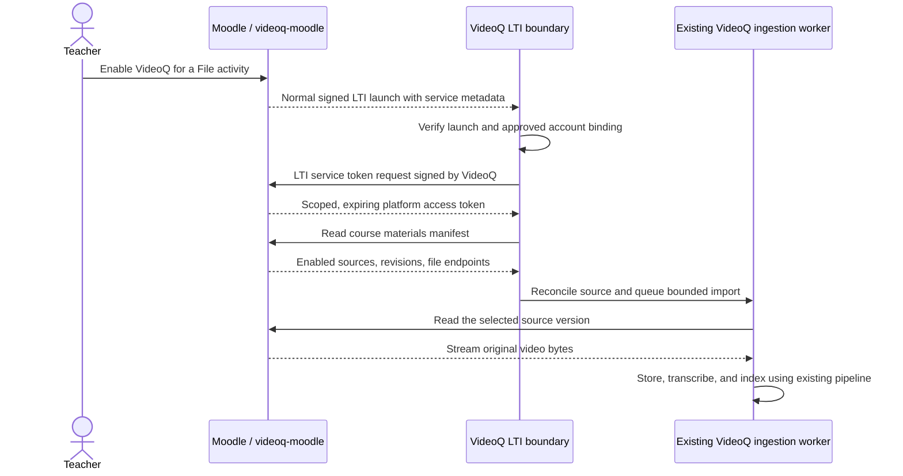

# LTI-only setup with a Moodle-hosted materials service

Status: historical proposal. Its media-pull transport is superseded by the
[accepted handoff decision](decision-lti-materials-handoff.md). Migration is not implemented. The current push-based integration and
its synchronization credential remain unchanged. This document is an architecture
assessment, not a claim of LTI certification or a completed migration.

## Decision

Use one approved LTI 1.3 registration for both launching VideoQ and authorizing
VideoQ to read an opted-in Moodle course's materials. Make `videoq-moodle` the
provider of a read-only materials service. VideoQ pulls those materials using the
LTI service authentication flow, then uses its existing video processing pipeline.

Do not introduce a separate synchronization API key, a new federation deployment,
or a standalone connector server. Do not expose general VideoQ video-management
permissions to Moodle merely because an LTI launch succeeded.

This is **LTI-only configuration and LTI-based authentication**, with a documented
materials-service extension. It is **not a promise that LTI Core or standard LTI
Advantage alone defines Moodle-to-VideoQ file synchronization**. The file and
permission data contract is an extension that the two implementations must support.

A completely unchanged VideoQ deployment cannot implement the complete workflow:
it currently has no client for this service or remote-file importer. The proposed
changes are limited to its LTI integration boundary and existing ingestion and
maintenance infrastructure. Moodle business rules belong in `videoq-moodle`.

## Requirements retained from the existing integration

- Moodle remains the original source of videos and the native video player.
- Teachers enable the question feature on an ordinary Moodle File activity.
- Moodle additions, replacements, renames, hiding, and deletion are reconciled.
- One Moodle course corresponds to one VideoQ course; questions can span its videos.
- Per-learner visibility, availability, and enrollment are checked before retrieval.
- Video switching, timestamp citations, streaming answers, ratings, and shared
  course conversation continue to work.
- An administrator approves one connection. There is no separately managed API key.
- The school-owned VideoQ account pays existing upload, storage, processing, and
  answer allowances. A learner cannot choose a different billing owner.
- Disconnecting blocks new launches, questions, and synchronization and retains
  already stored data. Deleting an opted-in source while connected removes its copy.
- No new deployment unit is introduced. Existing API, worker, database, storage,
  queue, and maintenance scheduling are reused.

## What LTI actually provides

LTI Core distinguishes platform-to-tool launches from tool-to-platform service
calls. Moodle is the platform; VideoQ is the tool:

| Flow | Requester | Verifier / token issuer | Existing trust |
|---|---|---|---|
| Launch | Moodle, through the user's browser | VideoQ verifies Moodle's signature | Moodle issuer and platform JWKS |
| Service authorization | VideoQ's backend | Moodle verifies VideoQ's client assertion | Tool client ID and VideoQ public keys |
| Material reads | VideoQ's backend | Moodle verifies its issued access token | Granted LTI service scope and tool registration |

The two directions have different messages and token audiences, but use the same
approved LTI registration. The tool's key is not Moodle's platform key. A learner's
launch ID token is never used as a service access token.

LTI Core sections 5.4.6 and 5.4.7 allow custom metadata; section 6 describes service
endpoint discovery and OAuth access tokens. OAuth Client Credentials with JWT
client authentication is already part of LTI service access. This proposal uses
that direction, instead of inventing a reverse Moodle-to-VideoQ token exchange.

Deep Linking selects content from a tool for the platform. Its `file` item is
specified in the tool-to-platform direction. It does not provide the reverse
course inventory, change feed, deletion notices, or per-user file permissions
needed here. NRPS lists memberships, not File activity visibility rules.

Sources:

- [LTI Core 1.3, custom properties and services](https://www.imsglobal.org/spec/lti/v1p3)
- [LTI Security Framework](https://www.imsglobal.org/spec/security/v1p0/)
- [Deep Linking 2.0, File item](https://www.imsglobal.org/spec/lti-dl/v2p0)
- [JWT client authentication, RFC 7523](https://www.rfc-editor.org/rfc/rfc7523.html)

### Other LTI extensions checked

Resource Search provides resource discovery, metadata, filtering, and pagination.
It is a possible future catalog interface, but does not on its own specify this
course's opt-in generations, deletion tombstones, version-pinned video transfer,
or per-activity learner permissions. The inspected Moodle LTI services do not
provide a Resource Search implementation. Adding it would still require a Moodle
provider and corresponding VideoQ consumer, so it does not make the deployment
unchanged. Do not label the proposed manifest as Resource Search compliant.

Asset Processor is another relevant LTI extension: Canvas documents a platform
asset-read service for processing assignment submissions and reporting results.
That shows that LTI-associated file retrieval is a valid direction; it does not
establish that the current Moodle File activities expose such a service. The
inspected Moodle 5.1.8+ source has no asset-processor service. Its assignment
submission lifecycle is also different from a library of teacher lecture videos.
Support for that standard could be a separate source reader when the target LMS
provides it. Do not force lecture videos into student assignments just to claim
standard-only synchronization.

- [Resource Search developer guide](https://www.imsglobal.org/spec/lti-rs/v1p0/devguide/)
- [Canvas Asset Processor documentation, vendor source](https://github.com/instructure/canvas-lms/blob/master/doc/api/document_processor.md)

## Setup and teacher workflow

1. The VideoQ account owner approves a platform issuer, client ID, deployment, and
   school account binding. This is the one LTI connection setup. An optional
   one-time pairing code may automate it; a pairing code is not an ongoing sync key.
2. The Moodle administrator installs the local UI plugin and the materials-service
   subplugin, registers VideoQ's LTI login/launch/redirect/JWKS URLs, and permits
   the read-only materials-service scopes for that tool.
3. A teacher enables VideoQ for a video. Moodle records the opt-in and creates or
   repairs its LTI activity and shared course entry entirely locally.
4. The same action opens a normal instructor LTI launch. Its signed metadata
   advertises the course materials service. This first launch authorizes discovery
   of the opted-in course and starts the initial import.
5. The first import shows a processing state. Learners can ask only about completed
   videos they may currently access. Additional videos join that VideoQ course.
6. Subsequent Moodle edits update the local material feed. VideoQ reconciles known
   courses in the background; it does not impersonate a logged-in teacher to do so.

A course that has never completed its first approved instructor launch is not
silently imported. The Moodle UI must clearly say that its initial connection is
pending. Existing mapped courses can be enrolled into the new mode during migration.

No repeated VideoQ login or key entry is required for learners. Administrator
approval is still necessary to associate the school account and its allowances;
an arbitrary Moodle cannot claim that it belongs to someone else's account.



## Keep Moodle-specific behavior in videoq-moodle

| Component | Responsibility |
|---|---|
| `local_videoq` | Native player/chat UI, teacher controls, opted-in source records, change revisions, deletion tombstones, Moodle access calculations, and service-token endpoint hardening |
| Proposed `ltiservice_videoq` | Service resource handlers, service configuration, scope definitions, and signed launch metadata |
| Existing `ltisource_videoq` | Compatibility during migration; retired once the service supplies equivalent launch metadata and live access checks |

The target still has two installed components: `local_videoq` plus
`ltiservice_videoq`. During migration all three can coexist. Moodle's service
subplugin already has `get_launch_parameters` and `get_jwt_claim_mappings`, so a
third permanent plugin is not necessary just to attach the descriptor.

Moodle resolves File activities, file storage, enrollments, groups, availability,
capabilities, hidden activities, and deleted courses. VideoQ consumes an opaque,
versioned source contract. No Moodle database access or filesystem paths cross
the boundary.

## Proposed service contract

The following URLs, custom field, scopes, and JSON shape are **proposal examples**,
not existing routes or registered 1EdTech specifications. Use an owned namespace
for the final profile; never pretend custom scopes are standard LTI scopes.

A verified launch carries a custom property such as `videoq_materials`. Because
LTI custom values are strings, its value is a JSON-encoded string, for example:

```json
{
  "version": "1",
  "token_endpoint": "https://moodle.example/local/videoq/lti/token.php",
  "manifest_url": "https://moodle.example/mod/lti/services.php/videoq/courses/42/materials",
  "access_url": "https://moodle.example/mod/lti/services.php/videoq/courses/42/access",
  "scope": "https://videoq.example/spec/lti-materials/scope/readonly"
}
```

Service endpoints must be fully resolved HTTPS URLs on the approved platform
origin, including installations under a path. The origin alone does not prove
that a URL is an allowed endpoint: enforce the descriptor profile and configured
endpoint policy too. Never discover issuers or JWKS from an untrusted JWT header,
fetch before launch verification, follow redirects to another host, or accept a
browser-supplied download URL. SSRF controls apply in the worker as well as the API.

### Read-only course materials

A manifest is a description of Moodle-owned state, not a command to manipulate an
arbitrary VideoQ ID. A source record includes:

- Opaque course/context ID, source activity ID, and associated LTI resource-link ID.
- Monotonically increasing source generation; file revision/content identifier.
- Title, byte length, supported MIME type, and version-bound content endpoint.
- Explicit state: active, hidden, disabled, or deleted.

For example:

```json
{
  "version": "1",
  "context_id": "42",
  "revision": "19",
  "complete": true,
  "next_cursor": null,
  "items": [
    {
      "source_id": "123",
      "resource_link_id": "456",
      "generation": "7",
      "state": "active",
      "title": "Introduction",
      "content_revision": "moodle-content-identifier",
      "content_type": "video/mp4",
      "bytes": 300317,
      "content_url": "https://moodle.example/mod/lti/services.php/videoq/courses/42/materials/123/content?generation=7"
    }
  ],
  "tombstones": []
}
```

Large courses require bounded pages from a consistent snapshot. Stage all pages
before applying deletions inferred from absence. Persist the cursor only after a
successful database reconciliation. Explicit tombstones may be applied earlier.
If the delta cursor is older than retained tombstones, require a complete snapshot
instead of claiming the delta is complete. Network failure, a partial page, 401,
403, 404, or a timeout is not proof of deletion.

Use Moodle's content hash as a change identifier, not an authentication mechanism.
Content endpoints enforce the selected generation and support bounded streaming
and resume/range where implemented. Do not return Moodle filedir paths or require
learner cookies. The access token remains on the server and is not sent to a
redirect destination. Exclude generated LTI/URL companion activities from sources.

### Live per-learner access

The access endpoint accepts the subject, context, and resource-link identifiers
from a verified LTI session, sent by the authenticated VideoQ tool. It returns only
the opted-in sources that the actual learner can currently view. Moodle resolves
its own LTI subject mapping; it must not trust a caller-supplied Moodle user ID
without that mapping.

A tool-level read token authorizes calling this endpoint; it does not grant the
learner access to all the tool's sources. Moodle validates the tool/deployment,
course usage, learner enrollment, capabilities, and activity restrictions.
VideoQ intersects the result with its own current connection/course/source mapping
and completed videos before retrieval, history, citations, and feedback.

OAuth access tokens can be cached until shortly before expiry. Permission results
are not reused after a revocation. Failure to obtain current permission denies the
question. This preserves the current behavior without a hardcoded Moodle PHP URL
in VideoQ's generic LTI boundary.

## Use LTI service authentication, with strict validation

VideoQ requests a platform access token using `grant_type=client_credentials`,
`client_assertion_type=urn:ietf:params:oauth:client-assertion-type:jwt-bearer`, and
a signed client assertion. The assertion has the tool's Moodle-issued client ID
in `iss` and `sub`, the exact materials token endpoint in `aud`, a short lifetime,
and a unique `jti`. A deployment claim binds it to the registered tool deployment.

VideoQ must supply a server-side tool signer and a public JWKS endpoint. The
current launch-only implementation has neither. Reuse the application's signing
infrastructure only after verifying its key access, purpose separation, rotation,
and deployment behavior; do not assume that publishing an existing unrelated
JWKS URL is sufficient. Private keys never go to a browser or a source manifest.

The Moodle plugin token handler must verify the signature and all relevant claims,
consume `jti` atomically, restrict requested scopes, and check the active tool and
local service grant. Reject learner launch tokens and assertions for another
endpoint, client, or deployment. Core Moodle signature verification alone is not
a substitute for verifying issuer, audience, lifetime, and replay policy.

The exact installed Moodle token endpoint must pass these negative tests before
being reused for the custom service. To avoid relying on undocumented validation,
the target design assigns the materials-specific token endpoint to `local_videoq`.
It speaks the standard LTI/OAuth client-assertion protocol and reuses the approved
LTI public keys and Moodle token storage; it introduces no separate API key or
identity provider. This service-specific endpoint is part of the documented
extension, not a claim about unmodified standard LTI Advantage.

Do not allow the stock token endpoint to bypass the stricter handler by minting
material tokens for the same scopes. The proposed service must keep its material
scope out of the stock endpoint's permitted-scope set and grant it only after the
plugin handler's checks. Verify this with an integration test. Resource handlers
must additionally check Moodle's current tool/course service grants on every
read; a platform token must not bypass a grant revoked in Moodle. VideoQ separately
checks its own connection on every incoming session request and before starting
or confirming imports. Scope alone is insufficient.

A disconnect initiated in VideoQ immediately disables its sessions, source reads,
and polling and drops its cached platform tokens. It cannot synchronously revoke
Moodle-issued tokens inside an unreachable Moodle. Those tokens retain their
platform-defined lifetime unless Moodle revokes the grant. Do not claim otherwise.
Moodle administrators can revoke the local tool/service grant. If policy requires
cross-system grant revocation from one button, add an authenticated self-revocation
service plus a durable retry; it is additional scope, not standard LTI magic.
Already accepted transfers may finish, but cannot activate a new mapping after
the connection has been revoked.

## Minimum necessary changes in VideoQ

No changes are proposed to model generation, RAG, standard account login, native
video management, or the general MCP/OAuth authorization server.

| Area | Required change | Reuse |
|---|---|---|
| LTI registration | Store approved service capabilities/endpoints and account binding; supply tool JWKS/signing | Existing issuer/client/deployment records and school account policy |
| LTI launch | Verify claims before resolving a pre-existing processed video; allow approved instructor bootstrap and a processing view | Existing nonce/browser binding, role checks, sessions, question view |
| LTI service client | Sign platform token requests, cache scoped tokens, read a versioned source/access profile | Existing `jose`, HTTP timeouts, pooling, permission intersection |
| Import adapter | Convert remote manifests to internal desired state; stream selected files into owned storage | Existing upload reservations, course/source mappings, `syncLmsResource`, confirmation, worker pipeline |
| Maintenance | Reconcile known opted-in contexts with a lease, cursor, retry, and bounded schedule | Existing queue, task scheduler, maintenance recovery, durable cleanup |
| Authorization | Use a discovered, approved access service rather than `courseAccess: "moodle"` and a hardcoded callback path | Existing per-question permission filtering and history revocation |

`syncLmsResource` already operates on an internal connection/owner grant; its
transactional quota, generation, membership, and deletion handling do not require
a bearer sync key. Keep this logic. Adapt inputs rather than copying it into PHP
or calling a public VideoQ API from inside VideoQ.

The current source reader returns upload URLs for Moodle to push to. The new
adapter needs a remote-file ingestion task. Run large downloads outside a launch
request; stream with byte limits to owned storage and confirm through the existing
pipeline. Validate MIME type, expected length, selected revision, and optional
checksum. Retries must not reserve quota or charge the same revision twice.
An interrupted transfer must recover or release its reservation normally.

Bootstrap must not require a completed binding before authenticating the launch.
Today `/login`, `verifyLaunch`, `/session`, and the registration resolver assume
prebound/processed resources. Split claim verification from resource resolution,
validate deployment membership independently, and create the empty owned course
and source subscription only after a permitted instructor launch. Learner roles
cannot bootstrap or broaden a subscription. A pending course gets a processing
state, not an unrestricted chat session.

These changes require a VideoQ release. They cannot be implemented entirely by a
Moodle plugin against the unchanged current launch-only endpoint. The extraction
base commit also lacks the uncommitted LTI implementation; estimates here are
relative to the inspected development working tree, not that base alone.

### Small, explicit data-model changes

Keep the existing connection, course, and resource identities. Add a connection
mode (`legacy_push` or `lti_pull`), approved platform token/service metadata, and
per-context cursor/reconciliation state. The exact storage layout can be a small
source-subscription table joined to the existing course mapping.

The current `lms_installations.sync_token_hash` is mandatory. Migrating pull mode
requires making it nullable with a mode constraint: legacy mode has a valid hash;
pull mode has none. Legacy bearer authentication and token rotation must reject
pull-mode connections. Do not retain an active fallback credential after mode
switching. Include source polling in the existing durable task/schedule model.

Persist the VideoQ account owner only from the administrator-approved connection.
Do not accept owner, billing allowance, internal course ID, or internal video ID
from the Moodle manifest. Store endpoint/profile changes only after a verified,
authorized launch and configured endpoint-policy checks. A changed issuer, client,
or deployment is a new trust decision, not an automatic metadata refresh.

## Addition, replacement, deletion, and mapping

| Moodle event | Moodle-side work | VideoQ-side work |
|---|---|---|
| Enable/add source | Check teacher capability, opt in, create LTI placement, publish source generation | On instructor bootstrap or next poll, reserve upload and import the new source |
| Replace bytes | Publish a new content revision and generation | Revoke old retrieval membership, import/process new bytes, clean up retired copy durably |
| Rename | Publish a new metadata generation | Update the title; reuse unchanged bytes and processed data |
| Hide/restrict | Publish source state and recompute live permissions | Remove from learner retrieval as required; retain the processed copy |
| Delete/explicitly disable source | Retain a tombstone even after File/course deletion | Revoke membership and delete only that connection's managed copy, vectors, transcript, and media |
| Delete generated companion only | Repair its local placement; preserve the source | Update placement metadata; do not treat it as source deletion |
| Disconnect | A Moodle-side disconnect revokes its tool/service grants; a VideoQ-side disconnect does not automatically edit Moodle | Reject sessions, stop new source reads/import confirmations and polling, discard cached platform tokens, retain stored data |

The mapping key is `(approved registration, deployment, context_id, source_id)`.
VideoQ chooses the account and internal IDs from that key. Moodle does not submit
a VideoQ user ID or an arbitrary video ID to delete. Never delete a native upload
or a different connection's copy merely because its bytes have the same hash.

A content read returning a different generation restarts reconciliation; it must
not confirm bytes as the old source. A 403 or missing content file alone never
causes destructive cleanup. Course deletion uses an authenticated collection
tombstone rather than treating loss of permission as deletion.

## Synchronization timing and deployment

Initial synchronization starts from the instructor launch. Thereafter a proposed
60-second reconciliation interval on active, known course subscriptions provides
addition/replacement/deletion propagation even when nobody is viewing the course.
This is an ordinary short background interval, not a requirement for nightly jobs.
The existing VideoQ maintenance runner drives it; no new daemon is necessary.

Use one shared lease per connection/context and exponential backoff on failure.
A successful change feed schedules imports; polling must not scan video bytes or
start an import per learner. A question can request a debounced refresh, but does
not run a full course import inline. Live access checks exclude a newly hidden or
deleted activity before the slower physical cleanup completes.

This explicitly trades Moodle push notifications for bounded VideoQ polling.
Zero-delay library cleanup is not promised; normal delay includes the poll,
queue, deletion worker, and frontend refresh. If zero-latency change notification
later becomes a requirement, it needs a separately designed authenticated signal.
Do not disguise a background webhook as a user LTI launch.

A disconnected connection stops synchronization, so Moodle deletions made while
it is disconnected do not delete retained VideoQ copies. On an authorized
reconnection, a complete reconciliation applies the current Moodle source state.
LTI placement removal alone must not silently mean permission to erase all data;
connection revocation and content deletion remain different operations.

## Alternatives considered

| Option | Entire current Moodle workflow? | Additional manually managed key? | Core effect | Decision |
|---|---|---|---|---|
| Standard LTI, content prepared in VideoQ | No automatic Moodle File synchronization | No | Small LTI-only scope | Valid strict-standard option, but changes the requested workflow |
| Import from short-lived file URLs in a signed LTI launch | Not for unattended updates/deletion unless a renewable source grant is added | No manual key, but persistent URL capabilities become credentials | Smaller launch-only importer, with delayed reconciliation | Useful limited mode; does not meet full current synchronization behavior |
| Existing push adapter | Yes | Hidden but separate sync credential exists | Current implementation | Keep as migration baseline |
| Push with reverse JWT/OAuth authentication | Yes | Not necessarily | VideoQ must authenticate a platform as a new API client and grant mutation rights | Feasible, but less aligned with LTI's normal service direction |
| Pull using platform LTI service authentication | Yes, with background reconciliation | No separate sync key | Generic LTI service client and importer; no new public VideoQ mutation auth scheme | Recommended target |
| Connector sidecar calling existing APIs | Only with sufficient generic API/auth support | Needs credentials or delegation to VideoQ | Extra deployment; current MCP has no answer tool and tRPC uses user sessions | Does not remove the underlying gap |

Choosing the pull approach does not claim it requires the fewest lines compared
with retaining the existing credential. It best meets the combined goals of one
LTI setup, standard LTI service authentication, no dedicated sync key, and Moodle
business logic isolated in `videoq-moodle`.

## Migration without replacing the current trial

1. Keep the current push mode and its credentials operational. Add a feature-gated
   materials-service plugin alongside existing components. Do not modify runtime
   behavior merely by installing a design document or probe.
2. Implement tool signing/JWKS and a generic service client in VideoQ, with tests.
   Add a platform-neutral profile and internal source-reader interface.
3. Implement strict scoped token issuance, manifest/content/access handlers, and
   source tombstones in `videoq-moodle`. Reuse the existing local source records.
4. Test a disposable course end to end. Confirm identical learner permission,
   streaming, citations, feedback, quota, replacement, deletion, and outage behavior.
5. Migrate one connection/context in place, retaining its installation, source,
   VideoQ course, video IDs, and history. Treat the first matching manifest as a
   metadata adoption, not a replacement upload. Never re-import solely because
   authentication or an LTI companion identifier changed.
6. Only one reconciliation authority may mutate a context. Switch modes atomically,
   stop its Moodle push jobs, invalidate the sync credential, and start the pull
   subscription. Rollback pauses pull before restoring push; do not run both.
7. Retire sync-key settings and legacy push endpoints only after migrated contexts
   are verified. Replace hardcoded Moodle access logic with the service profile.
   Retire `ltisource_videoq` only after its proof behavior has an equivalent path.

## Acceptance criteria before implementation is called complete

- Administrator setup exposes one LTI connection, without a sync-key field.
- A valid instructor launch bootstraps an empty enabled course; a learner cannot
  bootstrap, select an owner, or attach an arbitrary source endpoint.
- Standard LTI without the materials extension still launches prebound content.
- Wrong signature, issuer, subject, audience, deployment, expiry, replay, and
  ungranted scope fail; a stock token request cannot bypass plugin checks.
- Tool key rotation works through registered JWKS without reentering credentials.
- No private key, assertion, platform access token, or media credential reaches the
  Moodle chat bridge, browser storage, logs, or public manifests.
- New videos and replacements complete real transfer, transcription, and retrieval.
- MIME/length/version mismatch, range resume, interrupted transfer, expired token,
  provider failure, and quota exhaustion recover without duplicate charges.
- Read errors, partial pagination, and permission loss never imply deletion.
- Deletion while nobody is viewing propagates within the configured reconciliation
  policy; other connections/native uploads are preserved.
- Per-activity permissions, hidden content, enrollment changes, and learner/course
  history isolation retain current fail-closed behavior.
- Disconnect invalidates existing sessions and stops polling without erasing data.
- Existing video IDs and question history survive in-place migration and rollback.
- The existing deployment shape remains sufficient; workers process large videos
  without buffering them in the API isolate. Benchmark the actual upload limit.

## Evidence and limits of this assessment

Inspected VideoQ base: `596eef52dfbbc518760111113da6f1e6fb879358`, plus its current
uncommitted LTI/synchronization implementation. Inspected Moodle source:
`a682566412e1d429b95ac8ef4351a518f61b94c5` (5.1.8+).

Relevant existing code:

| Location | Finding |
|---|---|
| VideoQ `features/lti/routes.ts`, `protocol.ts`, `config.ts`, `registrations.ts` | Launch-only, prebound resources; platform signatures verified; no outgoing tool service signer |
| VideoQ `features/lti/course-access.ts` | Existing live permission intersection, currently hardcoded to Moodle |
| VideoQ `features/lms/routes.ts`, `repositories/lms-resource-repository.ts` | Push upload URLs; internal generation/quota/course/delete logic is reusable |
| VideoQ `lib/auth.ts` | General OAuth provider currently enables authorization-code/refresh grants for MCP; library capability is not an enabled materials API |
| Moodle `mod/lti/token.php`, `classes/local/ltiservice/service_base.php` | Platform token issuance and service subplugin interfaces exist |
| Moodle `mod/lti/service/memberships/classes/local/service/memberships.php` | Reference implementation for scopes and launch-service metadata |
| Plugin `local_videoq/classes/synchronizer.php`, `course_access.php` | Existing opt-in records, source revisions, live Moodle permissions, and deletion handling |

A live, isolated [service-auth probe](../evidence/lti-service-auth-probe.json)
confirmed that stock Moodle issues an access token for a temporary registered
tool's valid signed request, rejects a different signing key and an unregistered
materials scope, and exposes the required service hooks. The probe requested no
roster or private material data and removed its temporary tool and tokens.

This proves the direction and extension mechanism, not a working materials
service, complete JWT validation, VideoQ JWKS hosting, background import, or
migration. The prototype used a standard NRPS read scope and an ephemeral inline
RSA public key; JWKS rotation and the custom scope remain implementation gates.
Run the optional probe only in the guarded lab with
`lab/probe-lti-service-auth.php` copied into its Moodle container. It changes no
VideoQ application files or real connection configuration.
